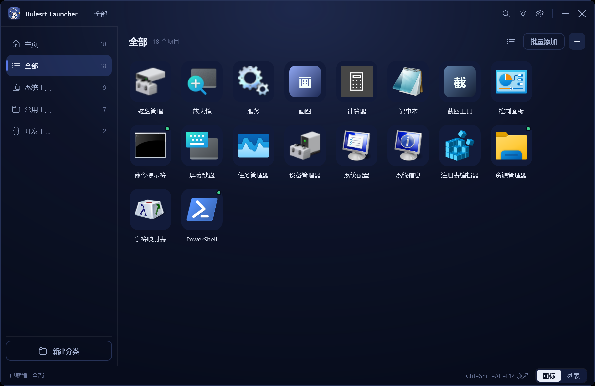
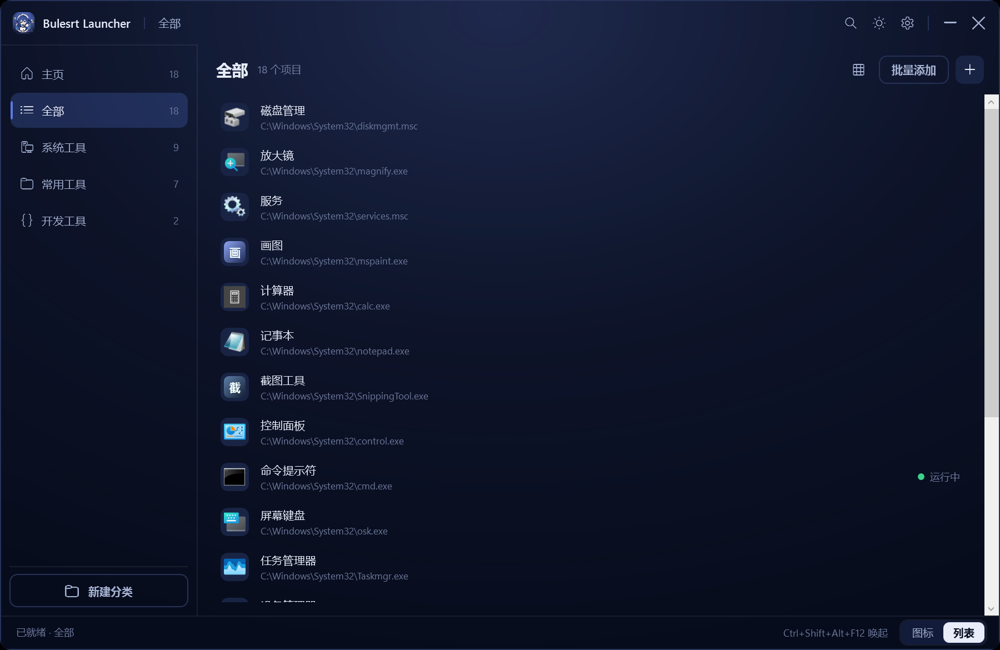
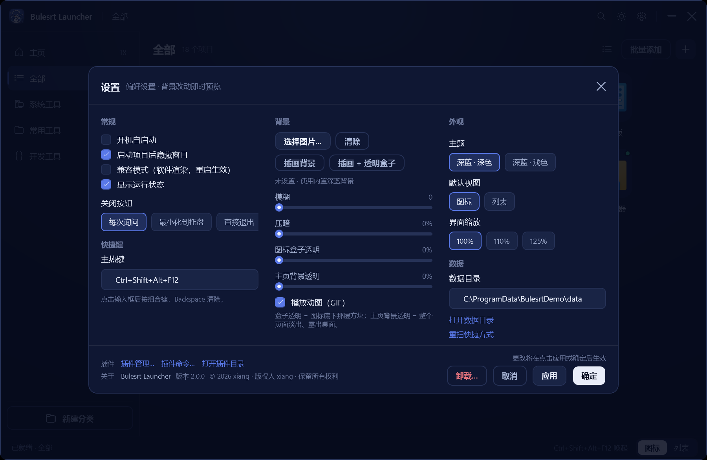
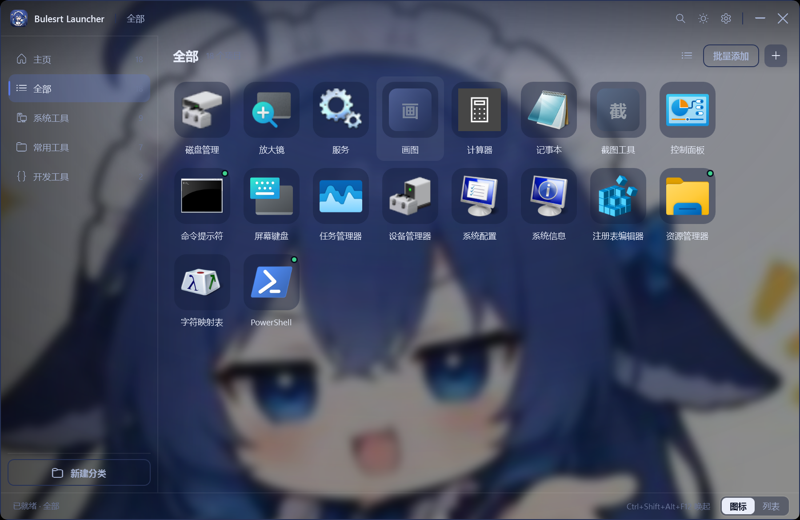

# Bulesrt Launcher

[](https://github.com/xiangxiang158/Bulesrt-Launcher/releases)
[](https://github.com/xiangxiang158/Bulesrt-Launcher/releases)
[](https://github.com/xiangxiang158/Bulesrt-Launcher/actions)
[](LICENSE)

> A Windows quick launcher with a deep-blue whale theme · .NET 8 + WPF · single file · fully local

Collect the exe / shortcut / URL / folder icons scattered across your desktop and Start menu into one place:
categories, search, one-click launch, multiple instances, live running status, plus a custom background (image or GIF).

No registry writes (unless you turn on autostart), no telemetry, no network calls — everything lives in `data\` next to the exe,
so copying the folder to another machine keeps your setup.



[中文说明](README.md)

## Features

| Area | What it does |
|---|---|
| Library | Add single items (name / target / args / working dir / category), paste many paths at once, drag & drop files, re-import desktop and Start-menu shortcuts |
| De-duplication | When a target already exists: overwrite or skip. `.lnk` is resolved to its real target, env vars expanded, case-insensitive |
| Views | Icon grid or list, 100% / 110% / 125% scale, dark & light themes, global hotkey (default `Ctrl+Alt+Space`) |
| Running status | Polls the process table every 3 s: green dot for running items; right-click to focus the window, kill the instance, or launch another one |
| Background | Local image or GIF, with blur / dim / icon-box transparency / whole-window transparency sliders, live preview |
| Plugins | Drop `plugins\<name>\plugin.json + dll`; each plugin gets its own `AssemblyLoadContext`, a crash never takes the app down |
| Uninstall | “卸载…” in the bottom-left of Settings; the installed build reuses `uninstall.exe`, the portable build has a built-in uninstaller |
| Installer | Offline payload or online URL / `setup.json`; registers an “Apps & features” entry, cleans shortcuts and autostart on uninstall |

## Screenshots

| Grid | List |
|---|---|
|  |  |

| Settings | Artwork + glass boxes |
|---|---|
|  |  |

## Download

**[Releases](https://github.com/xiangxiang158/Bulesrt-Launcher/releases)**

| Asset | Size | Notes |
|---|---|---|
| `BulesrtLauncher-2.0.0-setup.exe` | 2.6 MB | installer, keeps your existing `data\` (recommended) |
| `BulesrtLauncher-2.0.0-setup-fresh.exe` | 2.6 MB | installer, backs up `data\` then ships an empty library |
| `BulesrtLauncher.exe` | 1.4 MB | portable single file, no installation |

Uninstall via Settings → bottom-left “卸载…”, or Windows “Apps & features”, or `uninstall.exe` in the install folder.

## Build from source

Requires **.NET 8 SDK** on Windows 10/11 x64.

```bat
git clone https://github.com/xiangxiang158/Bulesrt-Launcher.git
cd Bulesrt-Launcher
build.cmd
```

Output:

```
dist\launcher\BulesrtLauncher.exe    single-file launcher (framework-dependent, ~1.4 MB)
dist\setup\BulesrtSetup.exe          installer (keeps existing data\)
dist\setup-fresh\BulesrtSetup.exe    installer (backs up data\ then installs an empty library)
```

The setup project embeds the published launcher as a resource, so the order matters —
`build.cmd` publishes the launcher first, then packs the installers.

## Layout

```
src/BulesrtLauncher/        the app (Views/, Services/, Themes/, Styles/, Assets/)
src/BulesrtSetup/           installer + uninstaller
src/BulesrtLauncher.Sdk/    plugin SDK
samples/HelloPlugin/        minimal plugin
docs/                       screenshots + architecture notes
```

## Data

`data\data.json` (library + settings), `data\background\`, `data\icon-cache\`, `data\backups\`, `data\launch.log`.
Delete `data\` for a fresh start; copy the whole folder to migrate.

## Known limitations

- Needs the **.NET 8 Desktop Runtime** unless you publish self-contained.
- On some GPU / remote-desktop setups the layered window may render black — enable *compatibility mode (software rendering)* in Settings → General.
- The window briefly disables background blur while you drag or resize it (a deliberate trade-off for smoothness).
- Icons are extracted at runtime from the programs on your machine; no third-party icon assets are bundled.

## License

[MIT](LICENSE) © 2026 xiang

Not affiliated with miHoYo, Steam or any game vendor. No game files are distributed.
