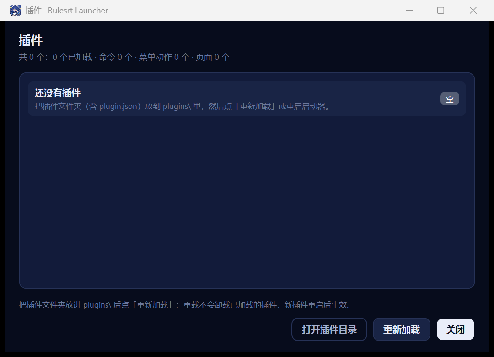

# Bulesrt Launcher

[](https://github.com/xiangxiang158/Bulesrt-Launcher/releases)
[](https://github.com/xiangxiang158/Bulesrt-Launcher/releases)
[](https://github.com/xiangxiang158/Bulesrt-Launcher/actions)
[](LICENSE)

> 深蓝鲸鱼主题的 Windows 快速启动器 · .NET 8 + WPF · 单文件 · 纯本地
>
> 仓库：[GitHub](https://github.com/xiangxiang158/Bulesrt-Launcher) · 国内镜像：[Gitee](https://gitee.com/disembarking/bulesrt-launcher)
>
>
> [English](README.en.md) · 参与开发见 [CONTRIBUTING.md](CONTRIBUTING.md) · 更新记录见 [CHANGELOG.md](CHANGELOG.md)

把散落在桌面、开始菜单里的 exe / 快捷方式 / 网址 / 文件夹收进一个界面：分类、搜索、一键启动、多开、看运行状态，再配一层自定义背景（图片或 GIF）。

程序不写注册表（除非你自己开「开机自启动」），不联网上报任何东西，所有数据都在安装目录的 `data\` 里，整个文件夹拷走就能换机器。


## 特性

| 模块 | 说明 |
|---|---|
| 收纳 | 单个添加（名称 / 路径 / 参数 / 工作目录 / 分类）、批量粘贴路径、拖拽文件进窗口、一键重扫桌面与开始菜单 |
| 去重 | 目标已存在时问「覆盖 / 跳过」，比较时解析 `.lnk` 真实目标、展开环境变量、忽略大小写 |
| 视图 | 图标网格 / 列表两种，界面缩放 100% / 110% / 125%，深浅两套主题，全局热键唤起（默认 `Ctrl+Alt+Space`） |
| 运行状态 | 每 3 秒扫一次进程：运行中的项目右上角亮绿点；右键可切窗口、结束实例、再开一个（多开） |
| 背景 | 本地图片或 GIF；模糊 / 压暗 / 图标盒子透明 / 主页背景透明 四个滑块，全部即时预览 |
| 透明 | 两种粒度：**图标盒子透明**把卡片压成半透；**主页背景透明**让整个背景层按像素透出桌面（分层窗口 + 自绘命中测试） |
| 插件 | `plugins\\<名字>\\plugin.json + dll` 自动加载，可加右键动作、插件命令、拦截启动、增删项目 |
| 卸载 | 设置左下角「卸载…」；安装版走 `uninstall.exe`，绿色版走内置卸载，可选是否连 `data\` 一起删 |
| 安装包 | 离线内置 / 在线链接（http(s) zip 或 setup.json）两种模式，装完写「应用和功能」卸载项 |

## 截图

| 图标视图 | 列表视图 |
|---|---|
|  |  |

| 设置 · 背景滑块 | 插画背景 + 透明盒子 |
|---|---|
|  |  |

| 插件管理 |  |
|---|---|
|  |  |

实现细节见 [`docs/ARCHITECTURE.md`](docs/ARCHITECTURE.md)。

## 下载与安装

**[→ 所有版本见 Releases](https://github.com/xiangxiang158/Bulesrt-Launcher/releases)**

| 下载 | 大小 | 说明 |
|---|---|---|
| [BulesrtLauncher-2.0.0-setup.exe](https://github.com/xiangxiang158/Bulesrt-Launcher/releases/latest/download/BulesrtLauncher-2.0.0-setup.exe) | 2.6 MB | **推荐**。安装包，覆盖安装、保留现有 `data\`，装完是空项目库 |
| [BulesrtLauncher-2.0.0-setup-fresh.exe](https://github.com/xiangxiang158/Bulesrt-Launcher/releases/latest/download/BulesrtLauncher-2.0.0-setup-fresh.exe) | 2.6 MB | 全新安装：先把现有 `data\` 改名成 `data.bak-时间` 备份，再放一份空库 |
| [BulesrtLauncher.exe](https://github.com/xiangxiang158/Bulesrt-Launcher/releases/latest/download/BulesrtLauncher.exe) | 1.4 MB | 绿色便携版单文件，双击即用，旁边自动生成 `data\` |

> 装完（或第一次运行）默认就是「蓝色插画背景 + 透明图标盒子」的深色外观。
> 安装包是单文件、离线内置的，不联网；默认装到 `%LOCALAPPDATA%\Programs\BulesrtLauncher`。
>
> 如果上面的链接打不开（还没发版），直接看 [Releases 页面](https://github.com/xiangxiang158/Bulesrt-Launcher/releases) 或按下面的方式自己编译。

> 国内网络下载慢的话，也可以到 [Gitee 镜像](https://gitee.com/disembarking/bulesrt-launcher) 的「发行版 / Releases」页面取同一个安装包。

**卸载**：设置 → 左下角「卸载…」，或 Windows「应用和功能」里点 Bulesrt Launcher，或直接运行安装目录里的 `uninstall.exe`。
卸载会清掉程序文件、桌面与开始菜单快捷方式、开机自启和「应用和功能」条目；`data\` 和 `plugins\` 默认保留（卸载界面里可以勾选一起删）。
绿色便携版直接删文件夹即可（先关掉「开机自启动」）。

## 从源码构建

需要 **.NET 8 SDK**（Windows 10/11 x64）。

```bat
git clone https://github.com/xiangxiang158/Bulesrt-Launcher.git
cd bulesrt-launcher
build.cmd
```

产物：

```
dist\launcher\BulesrtLauncher.exe     单文件启动器（框架依赖，约 1.4 MB）
dist\setup\BulesrtSetup.exe           安装包（覆盖安装）
dist\setup-fresh\BulesrtSetup.exe     安装包（全新安装）
```

> 安装器把启动器 exe 当**嵌入资源**打包，所以顺序不能反：先发布启动器 → 拷进 `src\BulesrtSetup\payload\` → 再打包安装器。`build.cmd` 做的就是这两步；
> 也要可以手动跑两条 `dotnet publish`（见 `build.cmd` 里的命令）。

要给没装 .NET 的机器，把 `--self-contained false` 换成 `true`（产物约 145 MB）。

## 项目结构

```
bulesrt-launcher/
├─ src/
│  ├─ BulesrtLauncher/        启动器（WPF 主程序）
│  │  ├─ Views/               MainWindow.*.cs 按功能拆分（设置 / 编辑 / 卸载 / 运行状态…）
│  │  ├─ Services/            图标、启动、存储、插件、平台、UI（主题 / 背景）
│  │  ├─ Themes/              Dark.xaml / Light.xaml 两套颜色令牌
│  │  ├─ Styles/              控件样式
│  │  └─ Assets/              ico / logo / 内置插画
│  ├─ BulesrtSetup/           安装器（安装 / 卸载 / 在线下载）
│  └─ BulesrtLauncher.Sdk/    插件 SDK（IPlugin 等接口）
├─ samples/HelloPlugin/       示例插件源码
├─ docs/                      截图 + 架构文档
├─ build.cmd                  一键构建
└─ LICENSE                    MIT
```

## 插件

插件是一个文件夹：`plugin.json` + 一个 dll，丢进 `plugins\` 即生效（重启启动器，或 设置 → 左下角「插件管理…」）。

```json
{ "id": "hello", "name": "Hello Plugin", "version": "1.0.0", "assembly": "HelloPlugin.dll" }
```

能做的事：给项目右键菜单加动作、注册插件命令、拦截某次启动、增删项目、弹提示、写日志（`data\plugins.log`）。接口见 [`src/BulesrtLauncher.Sdk`](src/BulesrtLauncher.Sdk)，最小示例见 [`samples/HelloPlugin`](samples/HelloPlugin)。

插件跑在自己的 `AssemblyLoadContext` 里，抛异常不会带崩启动器，失败原因会显示在插件管理窗口。

## 数据都在哪

```
data\
├─ data.json        项目库 + 设置（唯一必须备份的文件）
├─ background\      自定义背景图 / GIF
├─ icon-cache\      提取出来的图标缓存（删了会自动重建）
├─ backups\         data.json 的历史备份
└─ launch.log       启动日志
```

不想要全部：删掉 `data\` 就是全新状态。想迁移：整个文件夹复制走。

## 已知限制

- 需要 **.NET 8 桌面运行时**；没装的机器请用自包含版。
- 个别显卡驱动 / 远程桌面环境下，分层透明窗口可能黑屏 —— 设置 → 常规 → 勾「兼容模式（软件渲染）」。
- 拖动窗口、缩放窗口时背景会暂时不模糊（为流畅度做了取舍），松手即恢复。
- 图标是运行时从你本机程序的系统图标提取的，仓库里不含任何第三方图标资源。

## 许可证

[MIT](LICENSE) © 2026 xiang

## 声明

这是一个个人项目，与米哈游（miHoYo）、Steam 及任何游戏厂商均无关联，也不分发任何游戏文件。「米哈游启动器 / MuMu 模拟器」等目录结构只是作为启动路径的兼容处理。
